<p align="center">
  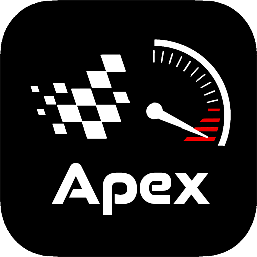
</p>

# Apex — Formula 1 in your pocket

[Русский](README.md) | [English](README.en.md)

**Apex** is a free Android app (Java) with Formula 1 statistics: results, race schedule, standings, driver and team pages, a neural-network qualifying prediction, and a prediction game with a player leaderboard.

Current version: **1.7** (`versionCode 14`).

## What's new in 1.7

- User predictions: Grand Prix winner, driver and team head-to-head duels, safety car, rain. Points for correct answers, a submission deadline, and editing or deleting an answer before the deadline
- Statistics inside each prediction: track history (rain, safety car), duel results, championship points
- Leaderboard, public profiles and medals (participation in the public leaderboard is confirmed with the first prediction)
- "All drivers" page, a driver's career seasons and their team in each season
- Team cars for all seasons and a quick year picker
- Offline mode: the app shows saved data without a network connection
- Redesigned driver, team and results pages, crash fixes

## Features

- Current and archived drivers' and constructors' standings
- Past and upcoming race weekends, race pages with circuit information and results
- Driver and team career statistics, saved favorite races, drivers and teams
- Neural-network qualifying results prediction
- Theoretical calculation of remaining championship contenders
- Push notifications about qualifying, races and stage completion
- Dark theme, Russian and English interface

## Screenshots

<p align="center">
  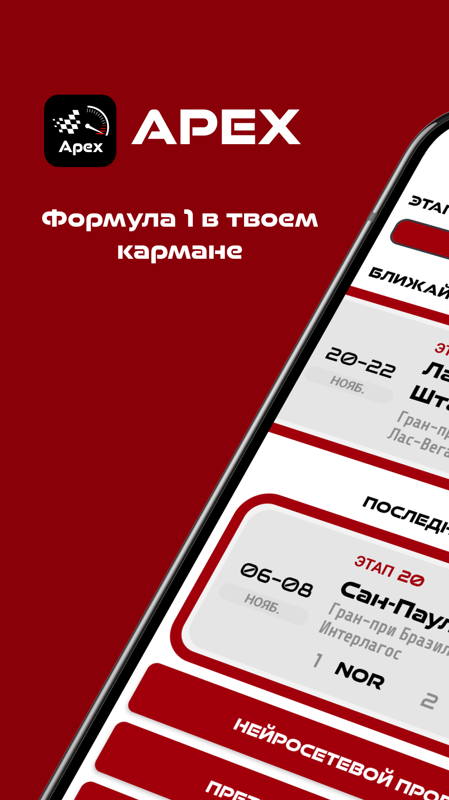
  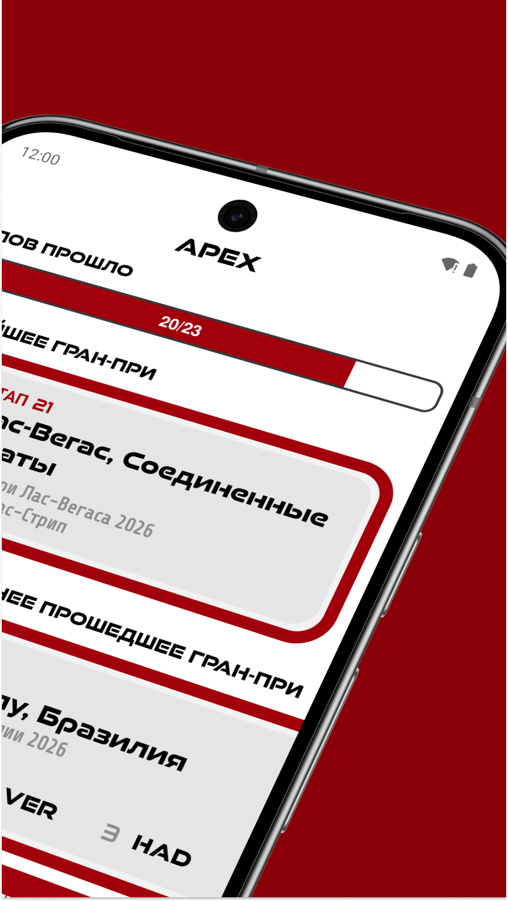
  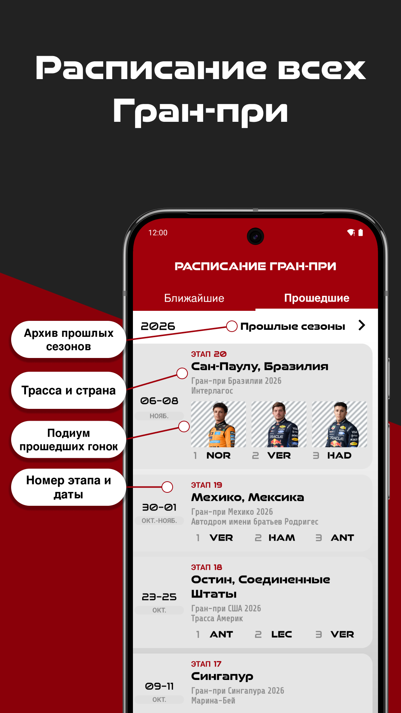
  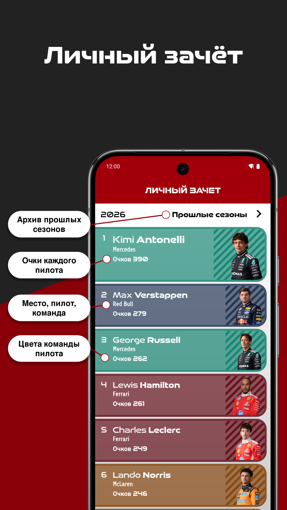
  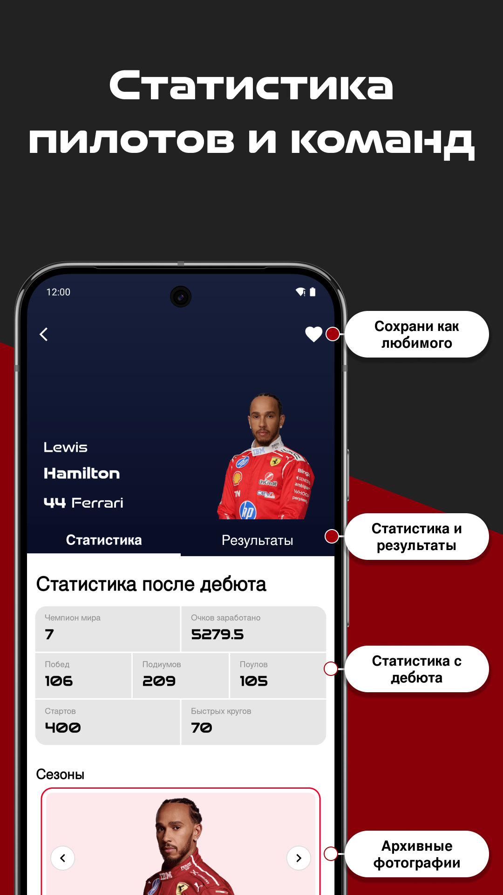
  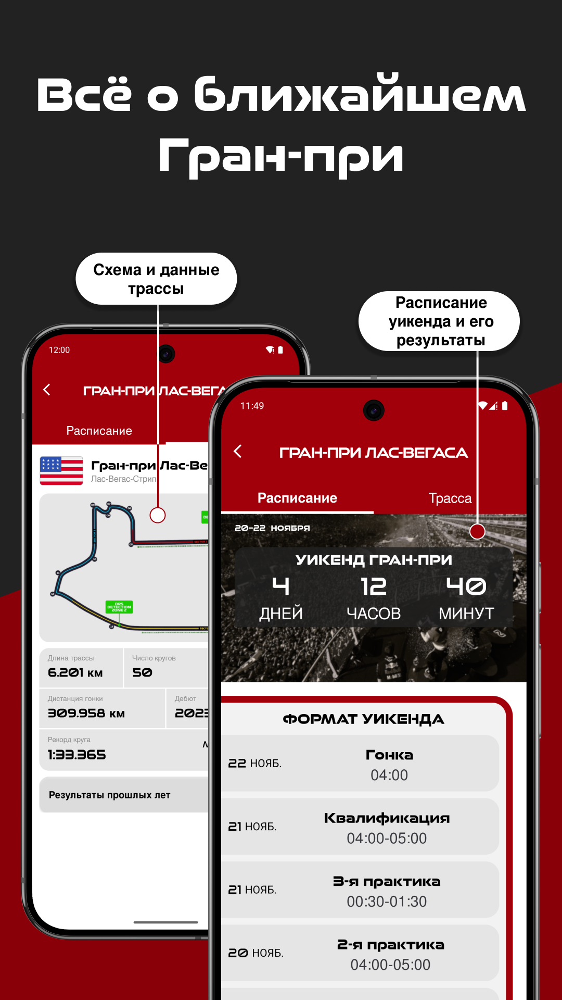
  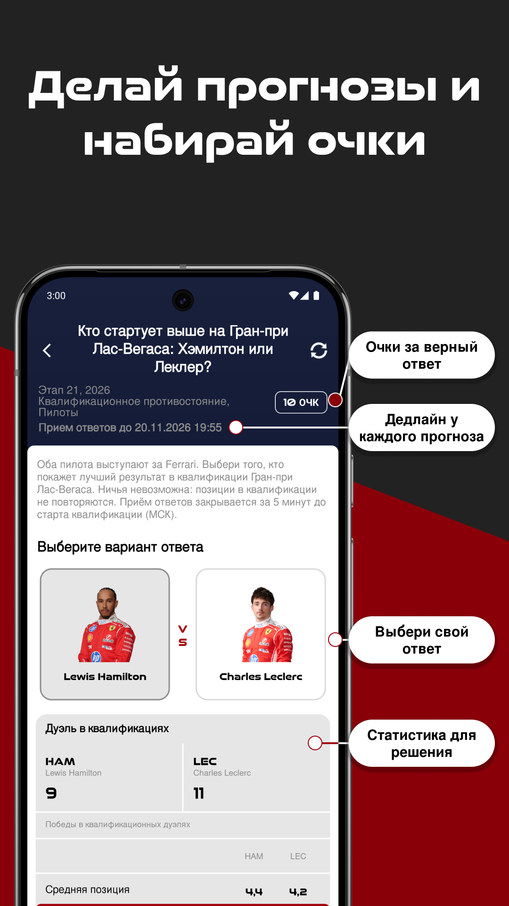
  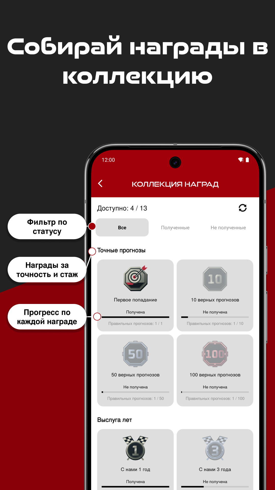
  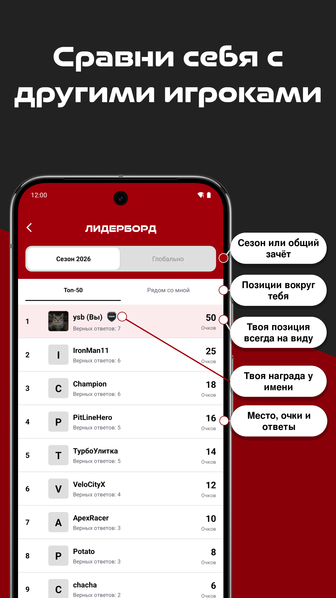
  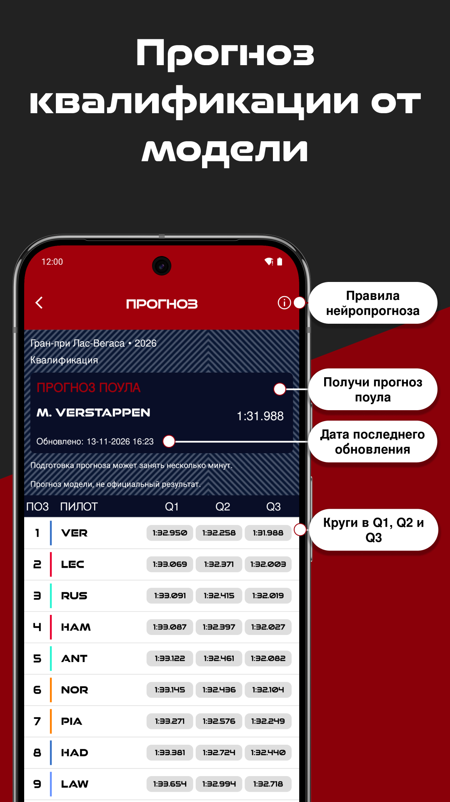
  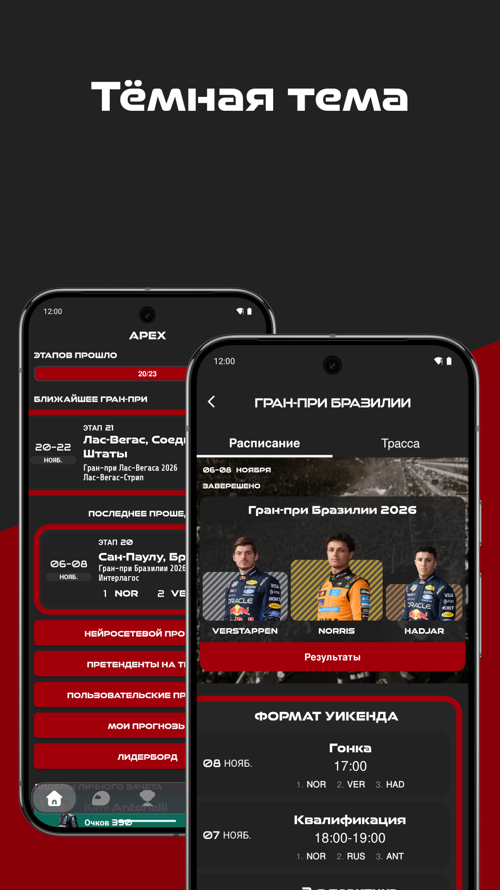
</p>

## Architecture

- **Client (this repository):** the Android app written in Java.
- **Backend:** Firebase Cloud Functions (answer submission, scoring, leaderboard, medals) and an admin panel for creating predictions and publishing results. These components live in private repositories and are not part of this one.
- **Data:** Firebase (Authentication, Realtime Database, Storage, Cloud Functions, Analytics), open APIs [Jolpica](https://github.com/jolpica/jolpica-f1) and [OpenF1](https://openf1.org).

Prediction results are published manually by an administrator according to the official FIA documents.

## Available in the store

<p align="center">
  <a href="https://www.rustore.ru/catalog/app/com.example.f1app">
    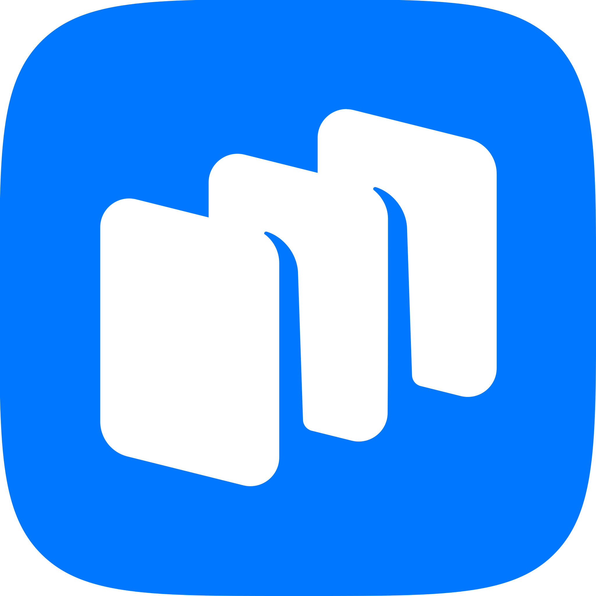
  </a>
</p>

## Requirements

- Android 8.0 (API 26) or newer
- About 50 MB of free storage
- Internet connection to load up-to-date data (saved data is available offline)

## Build

1. Clone the repository:
   ```
   git clone https://github.com/qum11ch/Apex.git
   ```
2. Open the project in Android Studio.
3. Connect your own Firebase project and add `google-services.json`.
4. Create `secrets.properties` based on `secrets.defaults.properties`.
5. Build and run the app.

> The backend is closed-source, so features that depend on it (predictions, leaderboard, medals) will not work without your own implementation on the Firebase side.

## License

MIT License. See the [LICENSE](LICENSE) file.

## Contact

Author: [qum11ch](https://github.com/qum11ch) · Email: f1.app@mail.ru

## Disclaimer

This application is unofficial and is not associated in any way with the Formula 1 companies.  
F1, FORMULA ONE, FORMULA 1, FIA FORMULA ONE WORLD CHAMPIONSHIP, GRAND PRIX and related marks are trade marks of Formula One Licensing B.V.
