<p align="center">
  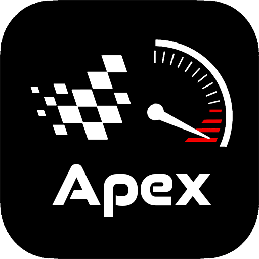
</p>

# Apex — Формула 1 в твоём кармане

[Русский](README.md) | [English](README.en.md)

**Apex** — бесплатное мобильное приложение для Android (Java) со статистикой Формулы 1: результаты, расписание, зачёты, страницы пилотов и команд, нейросетевой прогноз квалификаций и игра в прогнозы с рейтингом игроков.

Текущая версия: **1.7** (`versionCode 14`).

## Что нового в 1.7

- Игра в пользовательские прогнозы: победитель Гран-при, дуэли пилотов и команд, машина безопасности, дождь. Очки за верные ответы, срок приёма, изменение и удаление ответа до срока
- Статистика внутри прогноза: история трассы (дождь, машина безопасности), результаты дуэлей, очки в чемпионате
- Таблица лидеров, публичные профили и медали (участие в публичном рейтинге подтверждается при первом прогнозе)
- Страница «Все пилоты», сезоны карьеры пилота и команда пилота в каждом сезоне
- Болиды команд за все сезоны и быстрый выбор года
- Офлайн-режим: приложение показывает сохранённые данные без сети
- Обновлённый дизайн страниц пилотов, команд и результатов, исправления вылетов

## Функции

- Текущий и архивные личный и командный зачёты
- Расписание прошедших и предстоящих уикендов, страницы гонок с информацией о трассе и результатами
- Статистика пилотов и команд за карьеру, сохранение любимых этапов, пилотов и команд
- Нейросетевой прогноз результатов квалификации
- Теоретический расчёт претендентов на чемпионство
- Push-уведомления о квалификациях, гонках и завершении этапов
- Тёмная тема, русский и английский языки

## Скриншоты

<p align="center">
  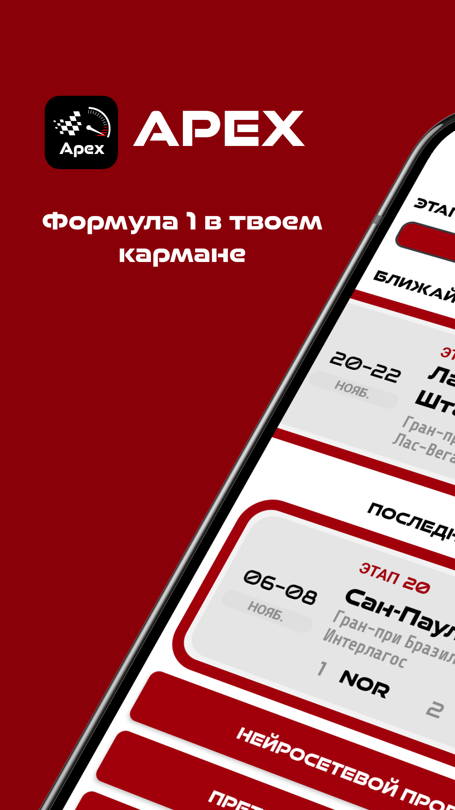
  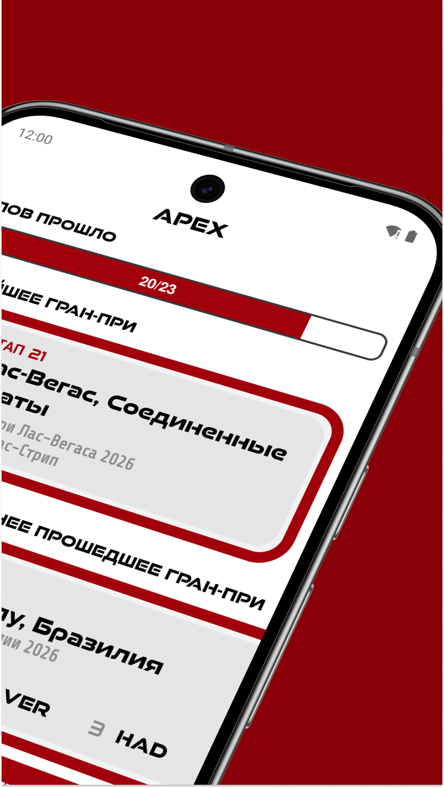
  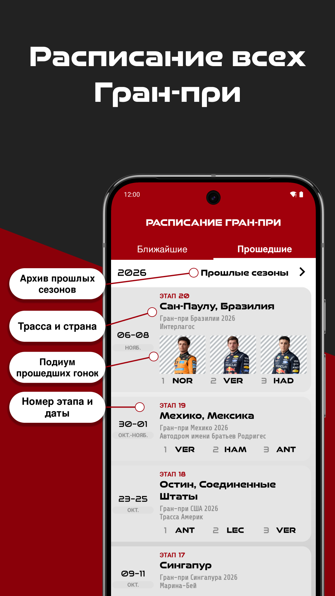
  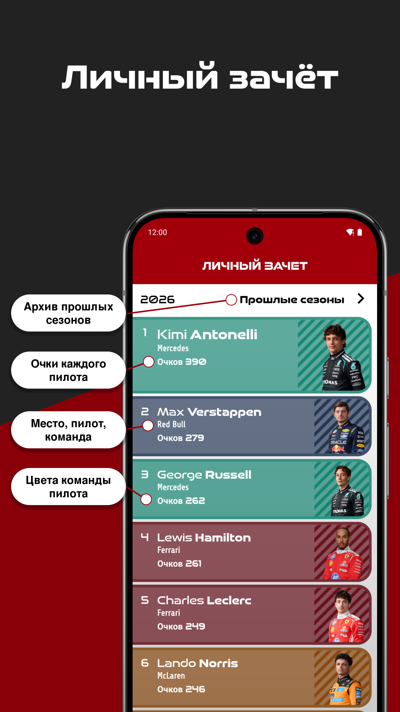
  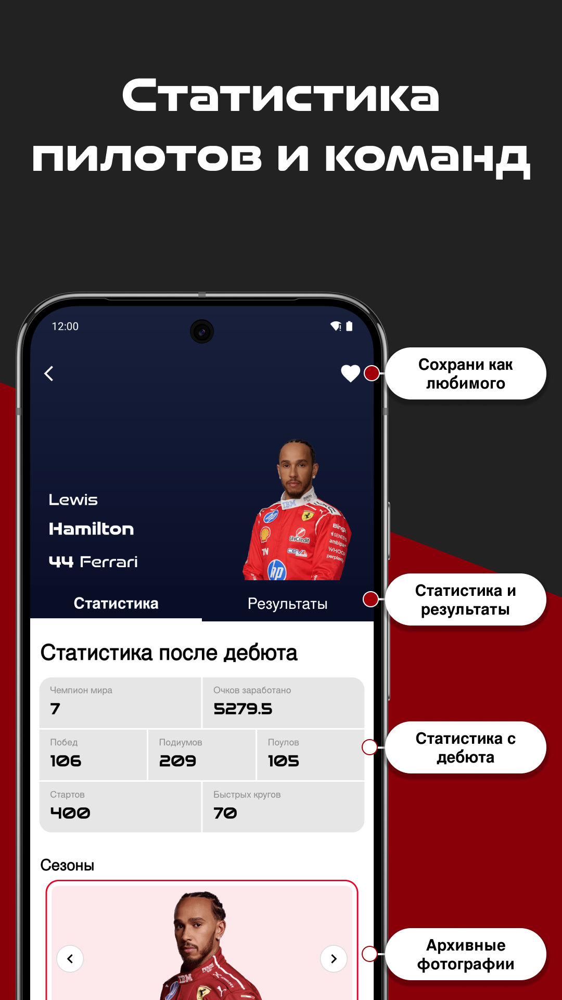
  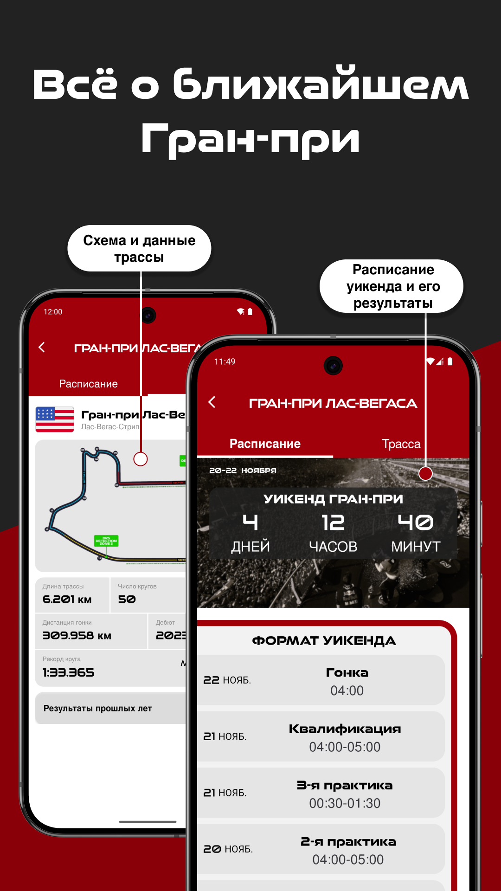
  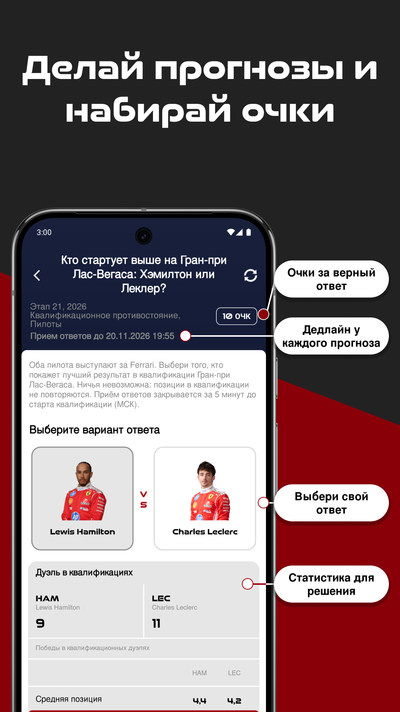
  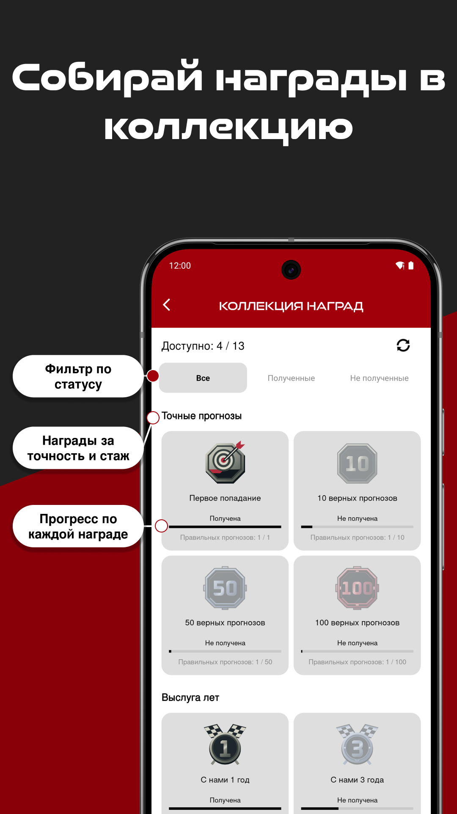
  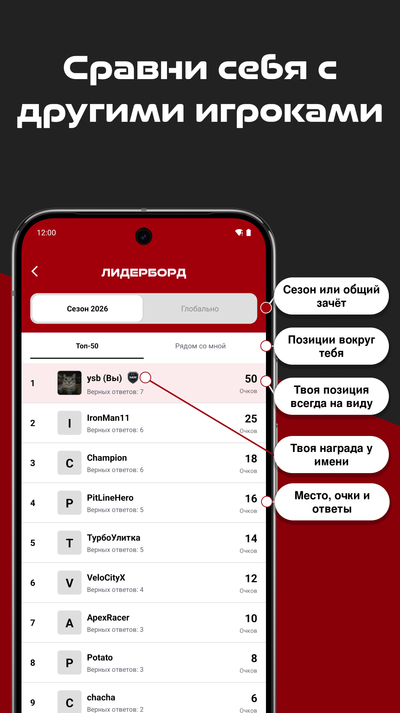
  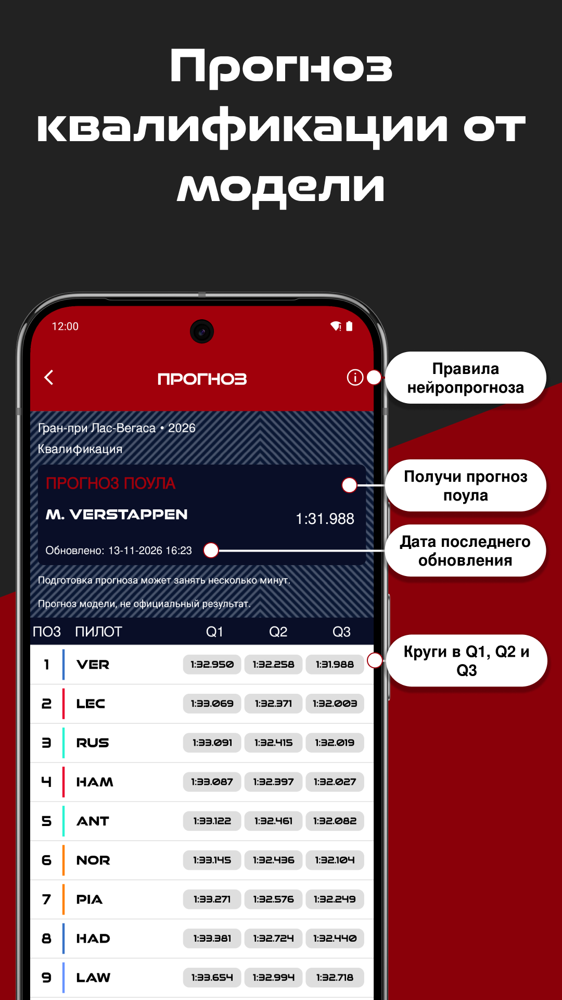
  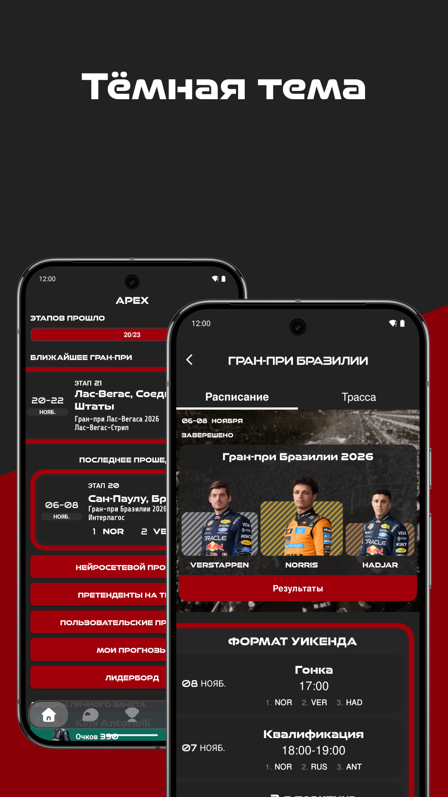
</p>

## Архитектура

- **Клиент (этот репозиторий):** приложение для Android на Java.
- **Серверная часть:** облачные функции Firebase (приём ответов, подсчёт очков, рейтинг, медали) и панель администратора для создания прогнозов и публикации результатов. Эти компоненты находятся в закрытых репозиториях и в данный репозиторий не входят.
- **Данные:** Firebase (Authentication, Realtime Database, Storage, Cloud Functions, Analytics), открытые API [Jolpica](https://github.com/jolpica/jolpica-f1) и [OpenF1](https://openf1.org).

Результаты прогнозов публикует администратор вручную по официальным протоколам FIA.

## Доступно в магазине

<p align="center">
  <a href="https://www.rustore.ru/catalog/app/com.example.f1app">
    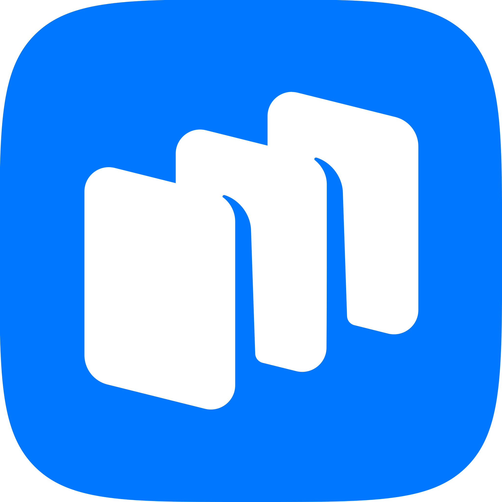
  </a>
</p>

## Требования

- Android 8.0 (API 26) и новее
- Около 50 МБ свободного места
- Интернет для загрузки актуальных данных (сохранённые данные доступны офлайн)

## Сборка

1. Клонируйте репозиторий:
   ```
   git clone https://github.com/qum11ch/Apex.git
   ```
2. Откройте проект в Android Studio.
3. Подключите собственный проект Firebase и добавьте `google-services.json`.
4. Создайте `secrets.properties` по образцу `secrets.defaults.properties`.
5. Соберите и запустите приложение.

> Серверная часть закрыта, поэтому функции, которые зависят от неё (прогнозы, рейтинг, медали), без собственной реализации на стороне Firebase работать не будут.

## Лицензия

MIT License. Подробнее в файле [LICENSE](LICENSE).

## Контакты

Автор: [qum11ch](https://github.com/qum11ch) · Email: f1.app@mail.ru

## Отказ от ответственности / Disclaimer

Это приложение является неофициальным и никак не связано с компаниями Формулы-1.  
F1, FORMULA ONE, FORMULA 1, FIA FORMULA ONE WORLD CHAMPIONSHIP, GRAND PRIX и связанные с ними знаки являются торговыми марками Formula One Licensing B.V.

This application is unofficial and is not associated in any way with the Formula 1 companies.  
F1, FORMULA ONE, FORMULA 1, FIA FORMULA ONE WORLD CHAMPIONSHIP, GRAND PRIX and related marks are trade marks of Formula One Licensing B.V.
